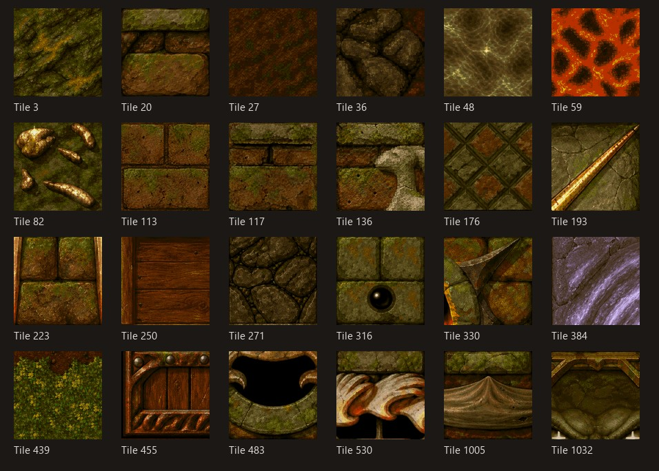

# Original terrain, enhanced at 4x

The bundle contains the 601 accepted 128 by 128 replacements for the original STANDARD A/B terrain: floors, walls, rooms, doors, gems, gold, water and lava. It preserves the original palette and world dimensions. Each tile is colour-matched to its original's average lightness and colour. Animated aliases resolve to their physical source frames.

All 601 PNGs are in `tiles/`; `terrain.index8.gz` contains the same indexed pixels, losslessly gzip-compressed. The installer decompresses them once and verifies both archive and decoded hashes before assembly; the installed pack is byte-identical to the uncompressed version. `manifest.json` records per-file hashes, source fingerprints, tile identities and the assembled pack hash. Installation reads original source pixels only from the local game installation. See the [installer and workflow](../../../local-dev/terrain/README.md) and [asset notice](NOTICE.md).
